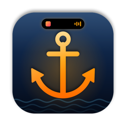

<p align="center">
  
</p>

<h1 align="center">Harbor ⚓️</h1>

<p align="center">
  Uma Dynamic Island para o notch do Mac, nativa, feita em SwiftUI.<br>
  Música, avisos, Claude Code, PRs, downloads, cópias, câmera e muito mais, tudo a um hover do topo da tela.
</p>

---

## Sumário

- [Recursos](#recursos)
- [Instalação](#instalação)
- [Compilar a partir do código](#compilar-a-partir-do-código)
- [Permissões](#permissões)
- [Integrações](#integrações)
- [Atalhos](#atalhos)
- [Estrutura do projeto](#estrutura-do-projeto)
- [Desenvolvimento e releases](#desenvolvimento-e-releases)
- [Solução de problemas](#solução-de-problemas)

## Recursos

### Notch fechado
Quando há algo acontecendo, o island cresce para os lados. A prioridade, da maior para a menor, é:

| Atividade | O que mostra |
|---|---|
| 🔔 **Avisos** | Volume, brilho, carregador, bateria fraca, fones Bluetooth, timer, Claude, PRs, downloads concluídos, microfone |
| 📅 **Reunião** | Contagem regressiva nos 10 minutos antes da reunião |
| ⬇️ **Download** | Anel de progresso com % ou tamanho |
| ✳️ **Claude Code** | Asterisco girando e o tempo de trabalho |
| 🎵 **Música** | Capa e visualizador (simulado ou real), com um brilho que pulsa |
| ⏱️ **Timer** | Tempo restante do Foco ou da Pausa |

**Bolhas** ao lado do island: microfone (em uso ou no mudo), apps fixados (com badges do Dock) e o odômetro do mouse.

### Abas (passe o mouse no notch ou aperte ⌥ Espaço)

| Aba | |
|---|---|
| **Início** | Música, CPU e bateria, timer Foco/Pausa (régua) e tarefas |
| **Mídia** | Player completo, ❤️ curtir e a fila do Spotify |
| **Copiados** | Histórico do ⌘C com busca; clique para colar |
| **PRs** | Seus PRs (checks de CI e revisões) e os que aguardam sua revisão |
| **Agenda** | Eventos do dia, com o botão **Entrar** em reuniões que têm link |
| **Bandeja** | Arraste arquivos até o notch; envie por AirDrop |
| **Espelho** | Câmera 1:1, com o island esticado para baixo |
| **Odômetro** | Distância que o mouse percorre, em metros, pés, ⚽ ou 🍌 |
| **Ferramentas** | Nota rápida, conta-gotas e monitor de rede |
| **Ajustes** | Geral, Visual (temas, Liquid Glass), Integrações e Apps fixados |

## Instalação

1. Baixe o `Harbor-X.Y.Z.dmg` em [Releases](../../releases) e arraste o app para **Aplicativos**.
2. Na primeira abertura, o app não é notarizado pela Apple. Clique com o botão direito em **Harbor › Abrir**, ou rode:
   ```bash
   xattr -dr com.apple.quarantine /Applications/Harbor.app
   ```
3. Em **Ajustes › Geral**, ative **Iniciar com o macOS**.

## Compilar a partir do código

**Requisitos:** macOS 14 ou mais novo e os Command Line Tools (`xcode-select --install`). O Xcode é opcional.

```bash
git clone https://github.com/Gustavo2022003/harbor.git && cd harbor
make signing   # uma vez por Mac: cria o certificado "Harbor Dev" (mantém as permissões entre builds)
make run       # compila e abre
```

| Comando | |
|---|---|
| `make build` | Gera `build/Harbor.app` |
| `make run` | Compila e abre |
| `make install` | Instala em `/Applications` |
| `make dist` | Gera `dist/Harbor-<versão>.zip` e `.dmg` |
| `make icon` | Regera o ícone a partir de `scripts/make-icon.swift` |
| `make signing` | Cria e instala o certificado de assinatura local |
| `make release VERSION=x.y.z` | Release (veja abaixo) |

> **Por que um certificado próprio?** O macOS associa as permissões (Acessibilidade, Gravação de Tela, Câmera…) à assinatura do app. Com a assinatura ad-hoc, cada build é visto como um app novo e as permissões se perdem. O certificado "Harbor Dev" deixa a assinatura estável.

## Permissões

| Permissão | Para quê | Obrigatória? |
|---|---|---|
| Automação (Spotify/Música) | Ler e controlar a música | Para a mídia |
| Acessibilidade | Colar automaticamente, substituir o aviso de volume e brilho, badges do Dock | Opcional |
| Gravação de Tela | Liquid Glass com refração e visualizador real | Opcional |
| Calendários | Agenda e reuniões | Opcional |
| Câmera | Aba Espelho | Opcional |
| Bluetooth | Avisos de fones | Opcional |
| Pasta Downloads | Downloads ao vivo | Opcional |

## Integrações

### Claude Code
Em **Ajustes › Integrações**, clique em **Instalar hooks**. Isso cria `~/.harbor/claude-hook.sh` e adiciona hooks em `~/.claude/settings.json`, com backup em `settings.json.harbor-backup`. Os eventos chegam ao Harbor pelo endereço `harbor://claude`.

### GitHub (PRs e CI)
Usa o [GitHub CLI](https://cli.github.com) já autenticado (`gh auth login`). A cada 90 s, o Harbor consulta seus PRs abertos e os pedidos de revisão.

### Spotify (fila e curtir)
1. Crie um app em [developer.spotify.com/dashboard](https://developer.spotify.com/dashboard), com o Redirect URI `http://127.0.0.1:47878/callback`.
2. Na aba **Mídia**, cole o **Client ID** e clique em **Conectar**. O token fica guardado no Keychain.

### Modo Foco do macOS
Crie dois atalhos no app Atalhos, um que liga e outro que desliga o "Não Perturbe", e informe os nomes em **Ajustes › Integrações**.

## Atalhos

| Atalho | Ação |
|---|---|
| ⌥ Espaço | Abrir / fechar |
| ⌥ V | Histórico de cópias, com a busca já selecionada |
| ⌥ N | Nota rápida |
| ⌥ M | Mudo do microfone |
| ⌥ P | Fixar o app que está na frente |
| ⌥ ⇧ C | Conta-gotas |
| Esc | Fechar |

## Estrutura do projeto

```
harbor/
├── Package.swift              # SwiftPM (executável "Harbor")
├── VERSION                    # versão atual (fonte da verdade)
├── CHANGELOG.md
├── Makefile
├── Resources/
│   ├── Info.plist
│   └── AppIcon.icns
├── Sources/Harbor/
│   ├── App/                   # AppDelegate, NotchController, NotchPanel, NotchViewModel
│   ├── Services/              # mídia, sistema, avisos, Claude, GitHub, Spotify, downloads…
│   └── Views/                 # island, abas e componentes
├── scripts/
│   ├── build.sh               # compila, empacota, assina (+ --run / --install / --dist)
│   ├── release.sh             # versão → merge dev→main → tag → release
│   ├── setup-signing.sh       # certificado "Harbor Dev"
│   └── make-icon.sh / .swift  # ícone gerado por código
├── docs/
│   └── ARCHITECTURE.md
└── .github/
    ├── workflows/ci.yml       # build em push/PR para dev e main
    └── workflows/release.yml  # build + assinatura + GitHub Release ao receber uma tag vX.Y.Z
```

Detalhes técnicos em [docs/ARCHITECTURE.md](docs/ARCHITECTURE.md).

## Desenvolvimento e releases

- **`main`**: produção, só recebe releases.
- **`dev`**: desenvolvimento.
- **`feat/*` e `fix/*`**: trabalho do dia a dia, mesclado em `dev` por PR.

Commits seguem o Conventional Commits. O fluxo completo está em [CONTRIBUTING.md](CONTRIBUTING.md).

```bash
# 1. em dev: mova as notas de "Unreleased" para "## [2.2.0] - AAAA-MM-DD" no CHANGELOG
# 2. publique:
make release VERSION=2.2.0          # tag → GitHub Actions compila, assina e publica
make release-local VERSION=2.2.0    # ou: compila, assina e publica a partir deste Mac
```

**CI/CD:**
- `ci.yml` compila a cada push ou PR em `dev` e `main` e guarda o `.zip` como artefato.
- `release.yml` publica a release com `.zip` e `.dmg`. Para assinar com o certificado estável, cadastre os segredos `HARBOR_P12_BASE64` e `HARBOR_P12_PASSWORD` no repositório.

## Solução de problemas

| Problema | Solução |
|---|---|
| Permissão dada, mas não funciona | Em Ajustes do Sistema › Privacidade, remova o Harbor (−) e adicione de novo. Depois de usar o `make signing`, isso deixa de acontecer. |
| `codesign` trava ao compilar | O macOS está pedindo acesso à chave "Harbor Dev": clique em **Sempre Permitir**. |
| Música não aparece | Permita a Automação do Spotify ou do Música em Ajustes do Sistema › Privacidade › Automação. |
| Aba PRs mostra um erro | Rode `gh auth status` e, se precisar, `gh auth login`. |
| Captura das abas para depuração | `build/Harbor.app/Contents/MacOS/Harbor --snapshot /tmp/shots` |

---

<sub>Feito com SwiftUI, AppKit e muito café. Repositório privado © Gustavo Gutierrez.</sub>
