<p align="center">
  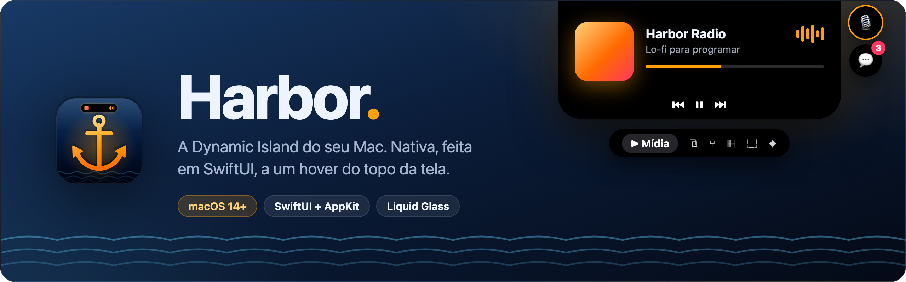
</p>

<p align="center">
  Música, avisos, Claude Code, PRs, downloads, cópias, câmera e muito mais, tudo a um hover do topo da tela.<br>
  <a href="../../releases/latest"><b>⬇️ Baixar</b></a> · <a href="docs/manual/Harbor-Manual.pdf"><b>📘 Manual (PDF)</b></a> · <a href="CHANGELOG.md"><b>📝 Novidades</b></a>
</p>

---

## Sumário

[Recursos](#recursos) · [Manual](#manual) · [Instalação](#instalacao) · [Compilar](#compilar) · [Permissões](#permissoes) · [Integrações](#integracoes) · [Atalhos](#atalhos) · [Estrutura](#estrutura) · [Desenvolvimento](#desenvolvimento) · [Problemas](#problemas)

<a name="recursos"></a>
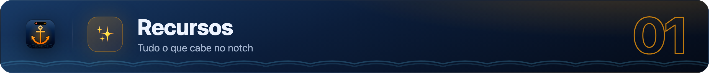


### Notch fechado
Quando há algo acontecendo, o island cresce para os lados. A prioridade, da maior para a menor, é:

| Atividade | O que mostra |
|---|---|
| 🔔 **Avisos** | Volume, brilho, carregador, bateria fraca, fones Bluetooth, timer, Claude, PRs, downloads concluídos, microfone |
| 📅 **Reunião** | Contagem regressiva nos 10 minutos antes da reunião |
| ⬇️ **Download** | Anel de progresso com % ou tamanho |
| ✳️ **Claude Code** | Asterisco girando e o tempo de trabalho |
| 🎵 **Música** | Capa e visualizador (simulado ou real), com um brilho que pulsa |
| ⏱️ **Timer** | Tempo restante do Foco ou da Pausa |

**Bolhas** ao lado do island: microfone (em uso ou no mudo), apps fixados (com badges do Dock) e o odômetro do mouse.

### Abas (passe o mouse no notch ou aperte ⌥ Espaço)

| Aba | |
|---|---|
| **Início** | Música, CPU e bateria, timer Foco/Pausa (régua) e tarefas |
| **Mídia** | Player completo, ❤️ curtir e a fila do Spotify |
| **Copiados** | Histórico do ⌘C com busca; clique para colar |
| **PRs** | Seus PRs (checks de CI e revisões) e os que aguardam sua revisão |
| **Agenda** | Eventos do dia, com o botão **Entrar** em reuniões que têm link |
| **Bandeja** | Arraste arquivos até o notch; envie por AirDrop |
| **Espelho** | Câmera 1:1, com o island esticado para baixo |
| **Odômetro** | Distância que o mouse percorre, em metros, pés, ⚽ ou 🍌 |
| **Ferramentas** | Nota rápida, conta-gotas e monitor de rede |
| **Ajustes** | Geral, Visual (temas, Liquid Glass), Integrações e Apps fixados |

<a name="manual"></a>
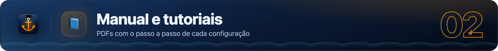

Para as partes que precisam de uma permissão, de uma conta ou de um ajuste, há um manual ilustrado com o passo a passo de cada configuração.

**📘 [Manual completo (PDF)](docs/manual/Harbor-Manual.pdf)**

Ou baixe só o tutorial que precisar:

| | Tutorial | O que resolve |
|---|---|---|
| 01 | [Instalação e primeira abertura](docs/manual/tutoriais/01-instalacao.pdf) | DMG, aviso “não pode ser aberto” e iniciar com o macOS |
| 02 | [Permissões do macOS](docs/manual/tutoriais/02-permissoes.pdf) | Para que serve cada uma e o que fazer quando não funciona |
| 03 | [Aviso de volume e brilho](docs/manual/tutoriais/03-hud.pdf) | Substituir o aviso nativo do macOS |
| 04 | [Liquid Glass e visualizador real](docs/manual/tutoriais/04-vidro.pdf) | Gravação de Tela e reinício do app |
| 05 | [Claude Code no notch](docs/manual/tutoriais/05-claude.pdf) | Instalar e remover os hooks |
| 06 | [PRs e CI do GitHub](docs/manual/tutoriais/06-github.pdf) | GitHub CLI, login e organizações com SSO |
| 07 | [Spotify: fila e curtir](docs/manual/tutoriais/07-spotify.pdf) | App de desenvolvedor e Client ID |
| 08 | [Timer → Modo Foco](docs/manual/tutoriais/08-foco.pdf) | Dois atalhos no app Atalhos |
| 09 | [Apps fixados, badges e microfone](docs/manual/tutoriais/09-pins.pdf) | Bolhas ao lado do notch |
| 10 | [Reuniões e downloads](docs/manual/tutoriais/10-agenda.pdf) | Calendários e pasta Downloads |
| 11 | [Solução de problemas](docs/manual/tutoriais/11-problemas.pdf) | Problemas comuns e atalhos |

> O manual é gerado a partir de `docs/manual/src/manual.html` com `make docs`. Para editar, mude o HTML e rode o comando de novo.

<a name="instalacao"></a>
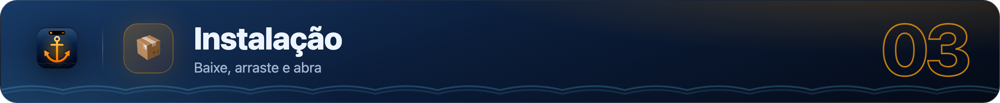


1. Baixe o `Harbor-X.Y.Z.dmg` em [Releases](../../releases) e arraste o app para **Aplicativos**.
2. Na primeira abertura, o app não é notarizado pela Apple. Clique com o botão direito em **Harbor › Abrir**, ou rode:
   ```bash
   xattr -dr com.apple.quarantine /Applications/Harbor.app
   ```
3. Em **Ajustes › Geral**, ative **Iniciar com o macOS**.

<a name="compilar"></a>
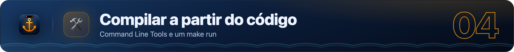


**Requisitos:** macOS 14 ou mais novo e os Command Line Tools (`xcode-select --install`). O Xcode é opcional.

```bash
git clone https://github.com/Gustavo2022003/harbor.git && cd harbor
make signing   # uma vez por Mac: cria o certificado "Harbor Dev" (mantém as permissões entre builds)
make hooks     # uma vez por clone: roda o CI local antes de cada git push
make run       # compila e abre
```

| Comando | |
|---|---|
| `make build` | Gera `build/Harbor.app` |
| `make run` | Compila e abre |
| `make install` | Instala em `/Applications` |
| `make dist` | Gera `dist/Harbor-<versão>.zip` e `.dmg` |
| `make ci` | CI local (veja abaixo) |
| `make hooks` | Ativa o CI automático antes de cada `git push` |
| `make docs` | Regera o manual em PDF e os banners do README (requer o Chrome) |
| `make icon` | Regera o ícone a partir de `scripts/make-icon.swift` |
| `make signing` | Cria e instala o certificado de assinatura local |
| `make release VERSION=x.y.z` | Publica uma release (veja abaixo) |

> **Por que um certificado próprio?** O macOS associa as permissões (Acessibilidade, Gravação de Tela, Câmera…) à assinatura do app. Com a assinatura ad-hoc, cada build é visto como um app novo e as permissões se perdem. O certificado "Harbor Dev" deixa a assinatura estável.

<a name="permissoes"></a>
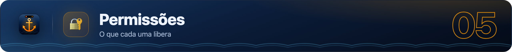


| Permissão | Para quê | Obrigatória? |
|---|---|---|
| Automação (Spotify/Música) | Ler e controlar a música | Para a mídia |
| Acessibilidade | Colar automaticamente, substituir o aviso de volume e brilho, badges do Dock | Opcional |
| Gravação de Tela | Liquid Glass com refração e visualizador real | Opcional |
| Calendários | Agenda e reuniões | Opcional |
| Câmera | Aba Espelho | Opcional |
| Bluetooth | Avisos de fones | Opcional |
| Pasta Downloads | Downloads ao vivo | Opcional |

O passo a passo de cada permissão está no [tutorial 02](docs/manual/tutoriais/02-permissoes.pdf).

<a name="integracoes"></a>
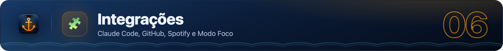


### Claude Code
Em **Ajustes › Integrações**, clique em **Instalar hooks**. Isso cria `~/.harbor/claude-hook.sh` e adiciona hooks em `~/.claude/settings.json`, com backup em `settings.json.harbor-backup`. Os eventos chegam ao Harbor pelo endereço `harbor://claude`.

📘 [Passo a passo ilustrado](docs/manual/tutoriais/05-claude.pdf)

### GitHub (PRs e CI)
Usa o [GitHub CLI](https://cli.github.com) já autenticado (`gh auth login`). A cada 90 s, o Harbor consulta seus PRs abertos e os pedidos de revisão.

📘 [Passo a passo ilustrado](docs/manual/tutoriais/06-github.pdf)

### Spotify (fila e curtir)
1. Crie um app em [developer.spotify.com/dashboard](https://developer.spotify.com/dashboard), com o Redirect URI `http://127.0.0.1:47878/callback`.
2. Na aba **Mídia**, cole o **Client ID** e clique em **Conectar**. O token fica guardado no Keychain.

📘 [Passo a passo ilustrado](docs/manual/tutoriais/07-spotify.pdf)

### Modo Foco do macOS
Crie dois atalhos no app Atalhos, um que liga e outro que desliga o "Não Perturbe", e informe os nomes em **Ajustes › Integrações**.

📘 [Passo a passo ilustrado](docs/manual/tutoriais/08-foco.pdf)

<a name="atalhos"></a>
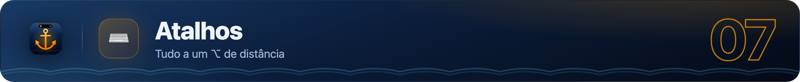


| Atalho | Ação |
|---|---|
| ⌥ Espaço | Abrir / fechar |
| ⌥ V | Histórico de cópias, com a busca já selecionada |
| ⌥ N | Nota rápida |
| ⌥ M | Mudo do microfone |
| ⌥ P | Fixar o app que está na frente |
| ⌥ ⇧ C | Conta-gotas |
| Esc | Fechar |

<a name="estrutura"></a>
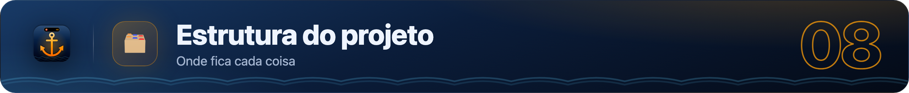


```
harbor/
├── Package.swift              # SwiftPM (executável "Harbor")
├── VERSION                    # versão atual (fonte da verdade)
├── CHANGELOG.md
├── Makefile
├── Resources/
│   ├── Info.plist
│   └── AppIcon.icns
├── Sources/Harbor/
│   ├── App/                   # AppDelegate, NotchController, NotchPanel, NotchViewModel
│   ├── Services/              # mídia, sistema, avisos, Claude, GitHub, Spotify, downloads…
│   └── Views/                 # island, abas e componentes
├── scripts/
│   ├── build.sh               # compila, empacota, assina (+ --run / --install / --dist)
│   ├── ci.sh                  # CI local (antes de push e release)
│   ├── make-docs.sh           # manual em PDF + banners
│   ├── release.sh             # versão → merge dev→main → tag → build → GitHub Release
│   ├── setup-signing.sh       # certificado "Harbor Dev"
│   └── make-icon.sh / .swift  # ícone gerado por código
├── .githooks/pre-push         # chama o scripts/ci.sh
├── docs/
│   ├── ARCHITECTURE.md
│   ├── manual/                # Harbor-Manual.pdf, tutoriais/*.pdf e a fonte em src/
│   └── banners/               # banners do README (fonte em src/banner.html)
└── .github/
    └── pull_request_template.md
```

Detalhes técnicos em [docs/ARCHITECTURE.md](docs/ARCHITECTURE.md).

<a name="desenvolvimento"></a>
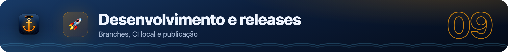


- **`main`**: produção, só recebe releases.
- **`dev`**: desenvolvimento.
- **`feat/*` e `fix/*`**: trabalho do dia a dia, mesclado em `dev` por PR.

Commits seguem o Conventional Commits. O fluxo completo está em [CONTRIBUTING.md](CONTRIBUTING.md).

```bash
# 1. em dev: mova as notas de "Unreleased" para "## [2.2.0] - AAAA-MM-DD" no CHANGELOG
# 2. publique:
make release VERSION=2.2.0   # merge dev → main, tag, compila, assina e publica no GitHub Releases
```

As releases são compiladas e assinadas neste Mac, com o certificado "Harbor Dev". O projeto não usa GitHub Actions.

### CI local

O `scripts/ci.sh` faz o papel de um CI, mas roda no seu Mac. Ele roda **sozinho antes de cada `git push`** (depois do `make hooks`) e **antes de cada `make release`**. Se algo falhar, o push ou a release são cancelados.

| Etapa | O que verifica |
|---|---|
| Projeto | `VERSION` no formato X.Y.Z, seção `[Unreleased]` no CHANGELOG, `Info.plist` válido, ícone, sintaxe dos scripts |
| Convenções e segurança | Nenhum `@State`; nenhum certificado, chave privada ou token do GitHub no repositório |
| Compilação | `swift build -c release` (mostra os erros e conta os avisos) |
| Teste de fumaça | Abre o app em modo `--snapshot` e confere se todas as abas renderizam (capturas em `.build/ci/shots`) |

Leva cerca de 30 s. Num push que não mexe em código (só docs, por exemplo), o teste de fumaça é pulado. Para pular tudo numa emergência: `git push --no-verify`.

<a name="problemas"></a>
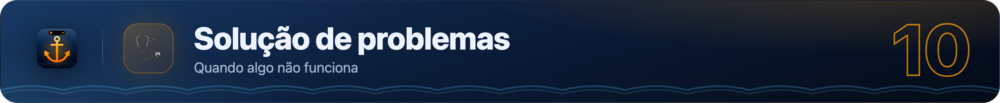


| Problema | Solução |
|---|---|
| Permissão dada, mas não funciona | Em Ajustes do Sistema › Privacidade, remova o Harbor (−) e adicione de novo. Depois de usar o `make signing`, isso deixa de acontecer. |
| `codesign` trava ao compilar | O macOS está pedindo acesso à chave "Harbor Dev": clique em **Sempre Permitir**. |
| Música não aparece | Permita a Automação do Spotify ou do Música em Ajustes do Sistema › Privacidade › Automação. |
| Aba PRs mostra um erro | Rode `gh auth status` e, se precisar, `gh auth login`. |
| Captura das abas para depuração | `build/Harbor.app/Contents/MacOS/Harbor --snapshot /tmp/shots` |

---

<sub>Feito com SwiftUI, AppKit e muito café. Repositório privado © Gustavo Gutierrez.</sub>
